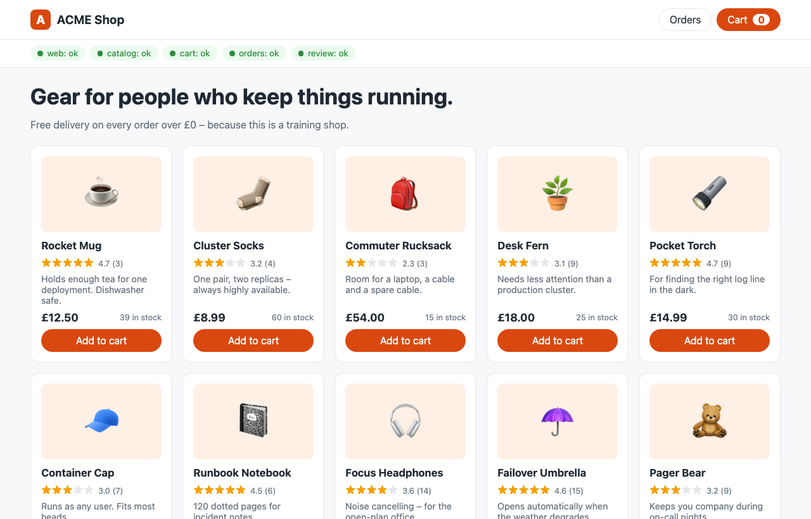

# Lab 2 – Deploy the complete "shop" (35 min)

The shop runs with one command – then you add what module 02 is about: a database as a
**StatefulSet**, an **init container** that waits for it, a **CronJob** that backs it up, and a
second Deployment that reads the backups from the same **RWX** volume.



**You will learn**

- how a multi-component application is wired: Deployments, Services, one Route
- why a database runs as a StatefulSet – stable name, own volume, own DNS entry
- how a CronJob creates Jobs, and how to start one right now
- what ReadWriteMany means: two Pods use the same volume at the same time

**How to work through this lab**

- Run every command from the folder `lab-02/` – all files are in it.
- Each task has the commands to copy, an explanation of what they do, the result to expect,
a **What to notice** box and a list of the most common problems.
- Stuck in task 5? `reference/cronjob.yaml` is the finished file.

## Before you start

```bash
export NS=sbx-ws00            # your namespace – set it first
oc project $NS
```

All files are in `lab-02/`; the commands below are run from there.

## Tasks

| # | Task | Time |
|---|---|---|
| 1 | Deploy the shop | 4 min |
| 2 | Switch off an optional service | 3 min |
| 3 | The database as a StatefulSet | 7 min |
| 4 | orders on PostgreSQL – with an init container | 6 min |
| 5 | The backup CronJob – complete it yourself | 9 min |
| 6 | Show the backup – a second pod on the same volume | 5 min |

---

### 1 · Deploy the shop

**Goal:** the complete shop running in your namespace, reachable in the browser.

```bash
oc apply -k shop
oc get deployment,service,route
oc rollout status deployment/web
ROUTE=$(oc get route web -o jsonpath='{.spec.host}')
echo https://$ROUTE
```

**What happens**

- `oc apply -k shop` renders `shop/kustomization.yaml` with Kustomize and applies the result.
The kustomization pulls in the shop's base manifests (`../../../shop/deploy/base`) and sets the
five images. You get the same result as with `kustomize build shop | oc apply -f -`.
- `oc get deployment,service,route` lists what was created.
- `oc rollout status deployment/web` waits until the web UI is ready.
- The last command prints the shop's URL.

**Expected result:** five Deployments (`web`, `catalog`, `cart`, `orders`, `review`), five
Services with the same names, one Route `web`. Open the URL, put something in the cart and place
an order.

> **What to notice:** five Deployments, five Services, one Route – one Pod per component, each
> scaled and updated on its own. `web` is the only way in; it calls the backends by their
> Service names. orders keeps your order in SQLite on an `emptyDir` – it is gone when the
> orders Pod is replaced.

**If it does not work**

- Pods in `ImagePullBackOff` – the cluster cannot pull the shop images. Ask the trainer.
- The page loads but shows errors in the status panel – some backends are not ready yet. Wait
for `oc get pods` to show all Pods `1/1 Running`.

---

### 2 · Switch off an optional service

**Goal:** see how the shop copes when one component is missing.

```bash
oc scale deployment/review --replicas=0
```

Reload the shop – then bring review back:

```bash
oc scale deployment/review --replicas=1
```

**What happens:** `oc scale --replicas=0` keeps the Deployment but stops all its Pods. The
Service `review` still exists – but has no endpoints, so web gets no answer from it.

**Expected result:** without review the star ratings disappear; browsing, the cart and orders
keep working. After scaling back to 1 the stars return.

> **What to notice:** without review the stars are gone, but you can still browse, fill the
> cart and order. Every component that calls another one must cope with "not there".

---

### 3 · The database as a StatefulSet

**Goal:** run PostgreSQL the way stateful software needs it: a fixed Pod name, its own volume and
its own DNS entry.

```bash
cat postgres/statefulset.yaml
oc apply -f postgres/
sleep 10
oc get statefulset,pod,pvc -l app.kubernetes.io/name=postgres
oc exec postgres-0 -- getent hosts postgres-0.postgres
```

Read `postgres/statefulset.yaml` first – the parts that differ from a Deployment:

| Field | Meaning |
|---|---|
| `kind: StatefulSet` | Pods get ordinal names: `postgres-0`, `postgres-1`, … |
| `serviceName: postgres` | the headless Service that gives each Pod a DNS name |
| `volumeClaimTemplates` | one PVC **per Pod**, created automatically: `data-postgres-0` |
| `envFrom: secretRef: postgres` | user, password and database from the Secret |

`oc apply -f postgres/` applies all three files of the folder: the Secret (demo credentials),
the headless Service (`clusterIP: None`) and the StatefulSet.

**What happens:** the StatefulSet creates the PVC `data-postgres-0`, waits until it is bound,
then starts the Pod `postgres-0`. `getent hosts` inside the Pod resolves the Pod's own DNS name.

**Expected result:** `statefulset.apps/postgres 1/1`, Pod `postgres-0` `Running`, PVC
`data-postgres-0` `Bound`; `getent` prints the Pod's IP and `postgres-0.postgres.<namespace>…`.
The first start takes a minute – PostgreSQL initialises its data directory.

> **What to notice:** the Pod is called `postgres-0` – not a random name – and it got its own
> PVC `data-postgres-0` from `volumeClaimTemplates`. The headless Service (`clusterIP: None`)
> gives every replica its own DNS name: `postgres-0.postgres`.

**If it does not work**

- PVC `Pending` – no default StorageClass, or quota exhausted: `oc describe pvc data-postgres-0`.
- Pod `ImagePullBackOff` – the cluster cannot pull from `registry.redhat.io`. Ask the trainer.

---

### 4 · Shop "orders" on PostgreSQL – with an init container

**Goal:** switch orders microservice from SQLite to PostgreSQL, and make it wait until the database is ready.

```bash
cat orders-postgres.yaml
oc patch deployment orders -p "$(cat orders-postgres.yaml)"
oc get pods -l app.kubernetes.io/name=orders -w        # Init:0/1 -> Running, then Ctrl-C
oc logs deployment/orders -c wait-for-db
```

`orders-postgres.yaml` is a **patch**, not a full Deployment – only the parts to add:

- `initContainers: wait-for-db` – runs `pg_isready -h postgres` in a loop until PostgreSQL accepts
connections. It uses the PostgreSQL image, which contains `pg_isready`.
- `env` for the `orders` container – `DB_USER`, `DB_PASSWORD`, `DB_NAME` from the Secret, and
`DATABASE_URL` built from them with `$(VAR)` references. As soon as `DATABASE_URL` is set,
orders uses PostgreSQL instead of SQLite.

**What happens:** `oc patch` merges the patch into the existing Deployment (strategic merge: the
container `orders` is matched by name, the init container is added). The changed Pod template
triggers a rolling update. `-w` watches the Pods change: `Init:0/1` while `wait-for-db` runs,
then `PodInitializing`, then `Running`. `oc logs … -c wait-for-db` shows the init container's
output.

**Expected result:** the log ends with `postgres:5432 - accepting connections`.

### 5 · The backup CronJob – complete it yourself

**Goal:** back up the database every five minutes into a shared volume.

First the volume:

```bash
cat backup/pvc.yaml
oc apply -f backup/pvc.yaml
oc get pvc backups                       # Bound? Pending = no RWX storage – ask the trainer
```

`backup/pvc.yaml` requests 2 GiB with `accessModes: ReadWriteMany` – the CronJob writes into it
while the viewer of task 6 reads from it, at the same time and possibly on different nodes.

Open `backup/cronjob.yaml` and fill in the three `TODO`s:

1. `schedule` – every 5 minutes, in cron syntax
2. `image` – the same image as the StatefulSet (see `postgres/statefulset.yaml`)
3. `claimName` – the PVC you just created

Hints:

- Cron syntax has five fields: minute, hour, day of month, month, day of week. `*/5` in the
minute field means "every fifth minute". Keep the quotes.
- The same image as the database means the same `pg_dump` version as the server.
- Read the rest of the file: the `PG*` variables are the standard libpq variables `pg_dump`
reads, the script writes to a temporary file first and keeps the newest 12 dumps.

```bash
oc apply -f backup/cronjob.yaml
oc create job backup-now --from=cronjob/db-backup      # do not wait 5 minutes
oc logs -f job/backup-now
oc get cronjob,job
```

**What happens**

- `oc apply` creates the CronJob – nothing runs until the schedule fires.
- `oc create job --from=cronjob/db-backup` creates a Job from the CronJob's template **now**.
- `oc logs -f job/backup-now` follows the Pod of that Job until it ends.

**Expected result:** `backup written: shop-<timestamp>.dump` and a file list; `oc get job` shows
`backup-now` with `1/1` completions.

Stuck? `reference/cronjob.yaml` is the finished file.

> **What to notice:** a CronJob creates a Job on schedule, the Job creates a Pod, the Pod runs to
> completion. `oc create job --from=cronjob/…` starts one right now – the same template, no
> waiting. `concurrencyPolicy: Forbid` stops two backups from running at the same time.

**If it does not work**

- `oc apply` rejects the file with `invalid schedule` or `Invalid value: "TODO"` – a TODO is
still in it.
- The Job's Pod stays `Pending` – the PVC is not bound (`oc get pvc backups`).
- `pg_dump: error: connection … failed` – PostgreSQL from task 3 is not running.

---

### 6 · Show the backup – a second pod on the same volume

**Goal:** a second Pod that reads the dumps from the same volume and shows them in the browser.

```bash
oc apply -f backup/viewer.yaml
oc rollout status deployment/backup-viewer
ROUTE=$(oc get route backup-viewer -o jsonpath='{.spec.host}')
echo https://$ROUTE
```

`backup/viewer.yaml` contains a Deployment, a Service and a Route. The Deployment runs
`python3.12 -m http.server` in the Python runtime image and mounts the PVC `backups`
**read-only** at `/backups`.

Open the URL – you see the dump the Job just wrote.

> **What to notice:** two Pods use the same PVC at the same time – the CronJob writes, the viewer
> reads. That is what **ReadWriteMany** is for; with ReadWriteOnce the second Pod would only
> start on the same node. The viewer is just the Python runtime image with `http.server` – no
> image of its own.

**If it does not work**

- The viewer Pod stays `ContainerCreating` – the volume cannot be attached: `oc describe pod -l app.kubernetes.io/name=backup-viewer`.
- The list is empty – no backup has finished yet; run the `oc create job` command of task 5
again with another name, e.g. `backup-now-2`.

---

## Cleanup

The shop of this lab is not used again – Day 2 deploys it fresh, with Argo CD, into its own
namespace. Delete everything, **including the volumes**:

```bash
oc delete -f backup/viewer.yaml
oc delete cronjob/db-backup job/backup-now
oc delete -f postgres/
oc delete -k shop
oc delete pvc backups data-postgres-0
```
